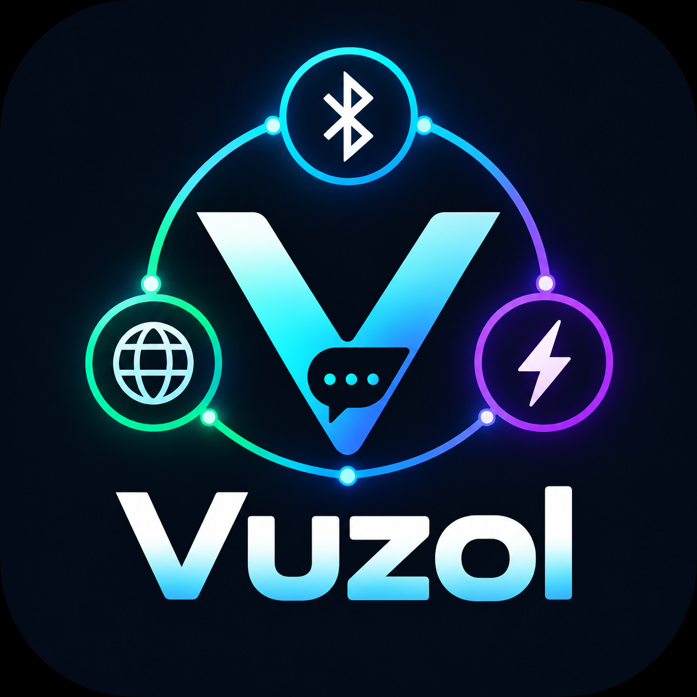

<p align="center">
  
</p>

<h1 align="center"><a href="https://github.com/dneese/vuzol-android">Vuzol</a></h1>

<p align="center"><strong>Приватний месенджер без акаунтів і серверів — спілкуйтеся напряму.</strong></p>

<p align="center">
  <a href="../../releases/latest"></a>
  <a href="../../releases/latest"></a>
  
  
</p>

**[Vuzol](https://github.com/dneese/vuzol-android)** — це форк [bitchat](https://github.com/permissionlesstech/bitchat-android) (v1.7.0) для Android із другим транспортним шаром, що працює через інтернет, і з протоколом [Nostr](https://nostr.com). Додаток підтримує три незалежні канали зв’язку, які можуть працювати одночасно: офлайн Bluetooth mesh, пряме peer-to-peer з’єднання через інтернет (libp2p + ICE) та релейне спілкування через Nostr. Усі повідомлення шифруються наскрізь (end-to-end). Без реєстрації, без номера телефону, без центрального сервера.

---

## Можливості

### Обмін повідомленнями
- Текстові повідомлення з форматуванням та підтримкою `@згадувань`
- Голосові повідомлення
- Обмін зображеннями та файлами (передача частинами)
- Підтвердження прочитання та індикатори доставки
- Канали, захищені паролем

### Транспортні шари
| Шар | Середовище | Потрібен інтернет |
|---|---|---|
| BLE Mesh | Bluetooth LE | Ні |
| P2P / ICE | Wi-Fi / мобільний інтернет | Так |
| Nostr | Wi-Fi / мобільний інтернет (релеї) | Так |

Усі шари працюють одночасно: застосунок сам обирає доступний маршрут і перемикається між ними. За замовчуванням увімкнено **Nostr** (саме він дає робочий інтернет-зв’язок), **P2P вимкнено** — його можна увімкнути у налаштуваннях транспортів. **Tor** — опціонально й за замовчуванням вимкнено; коли він увімкнений, застосунок переходить на прямий канал, якщо проксі не піднявся.

### Локація та канали
- Публічні канали за геоhash (від міста до країни)
- Вибір локації на карті OpenStreetMap **без API-ключа** — оберіть країну, знайдіть місто або пересувайте карту
- Власні групові чати
- Автоматичний пошук людей у вашій області

### Безпека
- **Noise Protocol** (Noise_NK, Curve25519 + ChaCha20-Poly1305) для всіх сесій
- **Ed25519-підписані QR-коди** для перевірки особистості сусіда
- **BouncyCastle PBKDF2** для хешування PIN-коду
- **EncryptedSharedPreferences** (AES-256-GCM) для всіх локальних секретів
- Біометрія та PIN-захист застосунку (за бажанням)
- GPS-координати не передаються — лише приблизний геоhash

### Приватність
- Не потрібні акаунт або номер телефону
- Немає центрального сервера: усе стан локальне або peer-to-peer
- Bluetooth mesh релеї використовують шифрування hop-by-hop
- Жодного доступу до контактів, журналу дзвінків, SMS чи зовнішніх акаунтів

---

## Архітектура

```
┌──────────────────────────────────────────────────────────┐
│                    Jetpack Compose UI                    │
├──────────────────────────────────────────────────────────┤
│                      ChatViewModel                       │
├───────────────────┬──────────────────┬───────────────────┤
│     BLE Mesh      │  P2P (libp2p)    │      Nostr        │
│                   │                  │                   │
│ BluetoothMesh     │ P2PTransport     │ NostrRelayManager │
│ Service           │ P2PLibraryRepo   │ NostrClient       │
│                   │ golib.aar (Go)   │                   │
├───────────────────┴──────────────────┴───────────────────┤
│              EncryptionService (Noise Protocol)          │
│              NoiseEncryptionService                      │
└──────────────────────────────────────────────────────────┘
```

### BLE Mesh
Рушій сітки з оригінального bitchat. Пристрої знаходять один одного через BLE-рекламу та сканування, обмінюються повідомленнями через GATT і пересилають пакети через сусідів за принципом TTL store-and-forward. Дублікати прибираються фільтром GCS Bloom (Gossip Sync).

### P2P Transport (libp2p)
Додатковий транспортний шар, унікальний для цього форку. Скомпільована бібліотека Go (`golib.aar`, зібрана через [gomobile](https://pkg.go.dev/golang.org/x/mobile/cmd/gomobile)) обгортає [**libp2p**](https://libp2p.io) — відкриту peer-to-peer бібліотеку від Protocol Labs, яку використовують IPFS, Filecoin та Ethereum 2. Вона дає:

- **Прямі ICE-з’єднання** між пірами крізь NAT і файрволи (після з’єднання сервер не потрібен)
- **Пошук пірів через DHT** на основі bootstrap-мережі IPFS
- **GossipSub** pub/sub для каналів за темами
- **Розбиття медіа на частини** — файли діляться на шматки ≤ 200 KB і надсилаються паралельно

### Nostr Transport
Використовує протокол [Nostr](https://nostr.com) для релейного обміну повідомленнями. Підтримує приватні DM (Curve25519-XChaCha20-Poly1305), геоhash-канали, proof-of-work і складання фрагментів великих повідомлень.

---

## Вимоги

| Вимога | Подробиці |
|---|---|
| Android | 8.0 (API 26) або новіше |
| Bluetooth | пристрій з підтримкою Bluetooth LE (BLE) |
| Дозволи | див. [Дозволи](#дозволи) |

---

## Збірка з вихідного коду

### Передумови
- Android Studio Hedgehog або новіше
- JDK 17
- Android SDK з API 35

### Клонування та збірка

```bash
git clone https://github.com/dneese/vuzol-android.git
cd vuzol-android
```

Відкрийте проєкт в Android Studio та синхронізуйте Gradle, або збирайте з командного рядка:

```bash
# Debug-збірка
./gradlew assembleDebug

# Release-збірка (потрібен підпис у local.properties)
./gradlew assembleRelease
```

### Підпис (Release)

Створіть `local.properties` (не комітиться) і додайте:

```properties
KEYSTORE_FILE=/path/to/your/keystore.jks
KEYSTORE_PASSWORD=your_keystore_password
KEY_ALIAS=your_key_alias
KEY_PASSWORD=your_key_password
```

### Розділення APK

Збірка автоматично створює окремі APK під кожну архітектуру:

| ABI | Суфікс файлу |
|---|---|
| arm64-v8a | `...-arm64-v8a-release.apk` |
| armeabi-v7a | `...-armeabi-v7a-release.apk` |
| x86_64 | `...-x86_64-release.apk` |

---

## Встановлення

### З готових релізів
1. Завантажте APK під архітектуру вашого пристрою зі сторінки [Releases](../../releases)
2. Увімкніть **«Встановлення з невідомих джерел»** у налаштуваннях Android
3. Відкрийте завантажений APK та встановіть

### З вихідного коду
Зберіть debug APK та встановіть через ADB:

```bash
./gradlew assembleDebug
adb install app/build/outputs/apk/debug/app-debug.apk
```

---

## Дозволи

| Дозвіл | Навіщо |
|---|---|
| `BLUETOOTH_SCAN / CONNECT / ADVERTISE` | пошук і спілкування з пірами BLE mesh |
| `ACCESS_FINE_LOCATION` | обов’язковий для Android під час сканування BLE |
| `ACCESS_BACKGROUND_LOCATION` |mesh працює, коли застосунок у фоні |
| `INTERNET` | транспорти P2P (libp2p) і Nostr |
| `FOREGROUND_SERVICE` | постійний фоновий mesh-релей |
| `RECEIVE_BOOT_COMPLETED` | автозапуск mesh після перезавантаження |
| `POST_NOTIFICATIONS` | сповіщення про нові повідомлення |
| `CAMERA` | сканування QR-кодів для перевірки сусіда |
| `RECORD_AUDIO` | голосові повідомлення |
| `READ_MEDIA_IMAGES / AUDIO / VIDEO` | обмін медіафайлами |
| `REQUEST_IGNORE_BATTERY_OPTIMIZATIONS` | стабільна робота у фоні |

**[Vuzol](https://github.com/dneese/vuzol-android)** **не** має доступу до контактів, журналу дзвінків, SMS чи будь-яких зовнішніх акаунтів.

---

## Перший запуск

1. **Запустіть** застосунок — реєстрація не потрібна
2. **Надайте дозволи**, коли з’явиться запит (Bluetooth, локація, сповіщення)
3. **Оберіть нік** — він зберігається лише локально та показується іншим
4. **Bluetooth**-група — це локальний BLE mesh; сусідні користувачі з’являються автоматично
5. Натисніть **+** на головному екрані, щоб приєднатися до геоhash-каналу (оберіть країну та місто на карті) або почати приватний чат
6. Відскануйте **QR-код** сусіда (з листа перевірки), щоб підтвердити його особистість
7. Угорі екрана показується статус каналу: **«Релеї підключено»** означає, що інтернет-зв’язок працює й залишилося дочекатися інших людей

### Захист застосунку (за бажанням)
**Налаштування → App Lock** — PIN-код і біометрія. Екран блокування з’являється щоразу, коли застосунок повертається з фону.

---

## Структура проєкту

```
app/src/main/java/com/roman/zemzeme/
├── crypto/            Noise protocol та симетричне шифрування
├── favorites/         Збереження пірів
├── geohash/           Локаційні канали та утиліти геоhash
├── mesh/              BLE mesh рушій (BluetoothMeshService, GALT-менеджери)
├── nostr/             Nostr-клієнт, менеджер релеїв, обробник DM
├── onboarding/        Перший запуск, налаштування захисту
├── p2p/               транспорт libp2p/ICE, складання чанків
├── security/          AppLockManager, хешування PIN
├── services/          QR-перевірка, особистість, фонові сервіси
├── ui/                екрани та листи Jetpack Compose
│   ├── theme/         кольорова схема (ElectricCyan), типографіка (Nunito)
│   └── media/         переглядач зображень, анімації файлів
└── MainActivity.kt    точка входу, навігація, життєвий цикл
```

---

## Стек технологій

| Компонент | Бібліотека / версія |
|---|---|
| UI | Jetpack Compose + Material 3 |
| Шрифт | Nunito (SIL OFL) |
| BLE | Nordic Semiconductor BLE library 2.6.1 |
| P2P | libp2p (Go, через gomobile · golib.aar) |
| Nostr | власний Kotlin-клієнт поверх OkHttp WebSocket |
| Шифрування | BouncyCastle 1.70, Google Tink 1.10.0 |
| Генерація QR | ZXing 3.5.4 |
| Сканування QR | ML Kit Barcode Scanning 17.3.0 |
| Камера | CameraX 1.5.2 |
| Локація | Google Play Services Location 21.3.0 |
| Біометрія | AndroidX Biometric 1.1.0 |
| Безпечне зберігання | AndroidX Security Crypto 1.1.0-beta01 |
| JSON | Gson 2.13.1 |
| Корутини | Kotlin Coroutines 1.10.2 |

---

## Участь у розробці

Pull request’и вітаються. Для великих змін спершу відкрийте issue, щоб обговорити підхід.

```bash
# Створити гілку з фічею
git checkout -b feature/your-feature

# Внести зміни та запушити
git push origin feature/your-feature
```

---

## Ліцензія

Проєкт успадковує відкриту ліцензію оригінального [bitchat](https://github.com/permissionlesstech/bitchat-android) та поширюється за ліцензією MIT (див. [LICENSE](LICENSE)). Бібліотека `golib.aar` скомпільована з [go-libp2p](https://github.com/libp2p/go-libp2p), ліцензія MIT.

---

## Подяки

- **[bitchat](https://github.com/permissionlesstech/bitchat-android)** — оригінальний проєкт, на основі якого зроблено цей форк. Дякуємо всій команді bitchat за міцну базу, орієнтовану на приватність, і за те, що проєкт відкритий.
- **[libp2p](https://libp2p.io)** — модульний peer-to-peer стек, що живить транспорт P2P/ICE.
- **[Protocol Labs](https://protocol.ai)** — автори libp2p, IPFS та ширшої децентралізованої інфраструктури, якою користується Vuzol.
- **[Протокол Nostr](https://nostr.com)** — простий відкритий протокол для децентралізованих соціальних застосунків.
